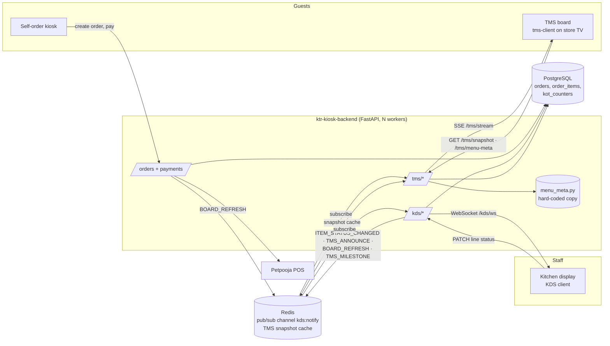
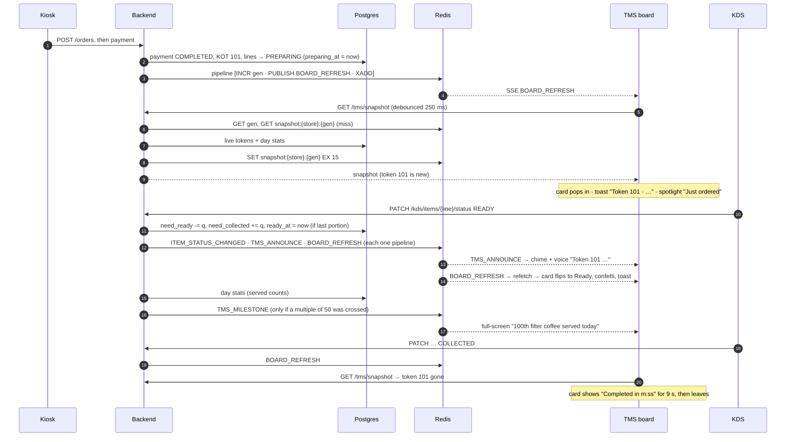
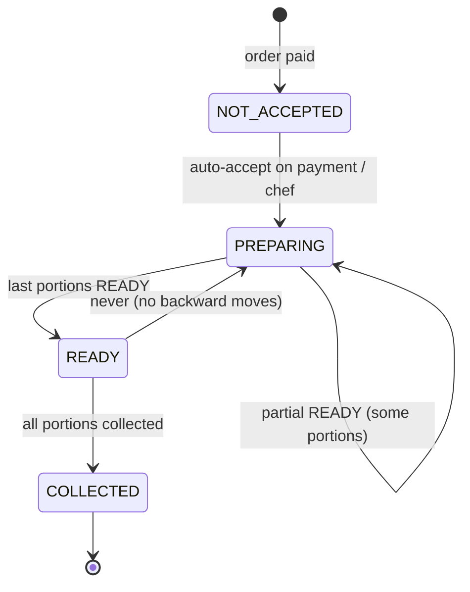

# KTR Token Board (TMS) — Architecture & Technical Design

How the customer-facing token board works end to end: who produces kitchen events, how they travel
through Redis to every TV, what the backend computes, and what the board does with it.

- API reference and feature guide: [`KDS-TMS-client-guide.md`](KDS-TMS-client-guide.md)
- Full HTTP API: [`API.md`](API.md)
- Frontend repo: `tms-client` (React 19 + Vite + TypeScript)

---

## 1. System overview



| Component | Role |
|-----------|------|
| **Kiosk / payments** | Creates the order, assigns the daily KOT number on payment, auto-accepts lines to `PREPARING`, emits `BOARD_REFRESH`. |
| **KDS** (`app/kds`) | Kitchen staff move each line `PREPARING → READY → COLLECTED` (optionally partial quantities). Every change commits to Postgres, then publishes events. |
| **TMS API** (`app/tms`) | Builds the token-centric snapshot (cached in Redis), serves hard-coded menu content, streams kitchen events to TVs over SSE. |
| **Redis** | One pub/sub channel (`kds:notify`) fans events out to every worker and client; a versioned key caches the TMS snapshot per store. |
| **tms-client** | The TV board. Loads snapshot + menu content, listens to SSE, diffs snapshots to drive animations, toasts, spotlight, milestones and voice. |

### Why SSE for the board (and WebSocket for KDS)

The board only **receives**; it never sends. SSE works over plain HTTP, reconnects automatically in
the browser, and passes through proxies that block WebSocket upgrades. The KDS uses WebSocket because
it is an interactive staff tool on the same event stream.

---

## 2. Life of an order on the board



Key ordering guarantee: **every writer commits to Postgres before publishing.** A board that refetches
on an event always reads the committed state.

---

## 3. Data model

### Tables used

| Table | Columns that matter to the board |
|-------|----------------------------------|
| `orders` | `id`, `store_id`, `order_id`, `order_type` (`DINEIN`/`TAKEAWAY`), `payment_status`, `kot_date`, `kot_number`, `kot_code` (`KTR-101`), `created_at` |
| `order_items` | `id`, `order_id` → `orders.id`, `item_name`, `quantity`, `items_need_be_ready`, `items_need_be_collected`, `order_status`, `addon_items`, **`preparing_at`**, **`ready_at`** |
| `kot_counters` | Per store per day counter; token numbers reset daily. |

### New columns (this feature)

| Column | Type | Set when |
|--------|------|----------|
| `order_items.preparing_at` | `TIMESTAMPTZ NULL` | First move to `PREPARING` (payment auto-accept or KDS), or a direct `READY` if it was never prepared. |
| `order_items.ready_at` | `TIMESTAMPTZ NULL` | The last portion of the line becomes ready (`items_need_be_ready` reaches 0). |

Migration: `scripts/add_order_item_kitchen_timestamps.sql` (idempotent, metadata-only, no table
rewrite). The app also runs the same `ADD COLUMN IF NOT EXISTS` on startup. Run it on **each primary
cluster**; read-only replicas receive it through replication. Existing lines keep `NULL` (shown as
"Ready" without a time).

### Line quantity model

A line of quantity *q* is tracked in portions, so part of a line can be ready:

```
quantity = (portions still cooking) + (portions waiting at counter) + (portions collected)
            items_need_be_ready        items_need_be_collected         (implicit)
```

`order_status` is derived by the KDS (`_derive_line_status`): `COLLECTED` when nothing is left,
`READY` when everything left is waiting at the counter, otherwise `PREPARING`.

---

## 4. State machines

### Line (KDS-driven)



### Token card on the board (`board_state`, computed server-side)

| `board_state` | Rule | Card look |
|---------------|------|-----------|
| `received` | Nothing ready and no line `PREPARING` | Glass card, hourglass, "In queue" items |
| `cooking` | Nothing ready, at least one line `PREPARING` | Orange-tinted, steam icon, item stage (On the tawa, Steaming, Frying, Brewing…) |
| `partial` | Some portions ready, some still cooking | Yellow border, half-filled icon, ticked ready items |
| `ready` | Every portion ready (nothing left to cook) | Solid orange with plaid strip, "Please collect at the counter", glow |
| `done` *(client only)* | Token left the snapshot (fully collected) | Green summary "Completed in m:ss · Kitchen time m:ss" for 9 s |

A token is on the board while it is paid and has at least one line not `COLLECTED` (max 200 tokens,
oldest first).

---

## 5. Redis design

Redis is used for exactly two things, both of which need to be shared across workers and processes:

### 5.1 Event fan-out — pub/sub channel `kds:notify`

- Every kitchen event is one JSON message `{"type": "...", "payload": {..., "store_id": N}}`.
- Each SSE connection (and each KDS WebSocket) holds a subscription and forwards messages whose
  `payload.store_id` matches its store.
- `emit_kitchen_event` sends **one pipelined round trip** per event: `INCR` the store's snapshot
  generation, `PUBLISH`, and `XADD kds:stream` (capped at ~10 000 entries).

> `kds:stream` is written but not read anywhere in this repo. Keep it only if an external consumer
> (audit, replay) uses it.

### 5.2 Snapshot cache — versioned per store

Every TV in a store asks for the same snapshot after every event, and building it costs two Postgres
queries (live tokens + today's stats). It is built once per change and shared:

| Key | Value | Written by |
|-----|-------|------------|
| `tms:snapshot:gen:{store_id}` | integer generation | `INCR` in every kitchen event for the store |
| `tms:snapshot:{store_id}:{gen}` | snapshot JSON, `EX 15` | First `GET /tms/snapshot` (or SSE connect) after a change |

Read path: `GET gen` → `GET snapshot:{store}:{gen}` → hit: return it with a fresh `server_time`;
miss: build from Postgres and `SET … EX 15`.

**Why a generation instead of `DEL`:** if a rebuild is in flight when an event lands, a plain delete
would let the slow rebuild write stale data back as current. With generations, that late write lands
under the old key, which nobody reads; the TTL cleans it up.

Failure behaviour: any Redis error is logged and the snapshot is built straight from Postgres. With
Redis down at startup, SSE falls back to keep-alive pings (no live events) and clients still poll
on reconnect.

### What deliberately does not use Redis

- **Store lookup per request** (`X-Store-Id` → `stores`): a primary-key query is about as fast as a
  Redis round trip, so caching it adds a moving part without a gain.
- **Menu content**: static Python constants, served from process memory.

---

## 6. Backend modules

| Module | Responsibility |
|--------|----------------|
| `app/tms/router.py` | `GET /tms/health`, `/tms/snapshot`, `/tms/menu-meta`, `/tms/stream` (SSE with subscribe, store filter, ping, reconnect backoff 1 → 10 s). |
| `app/tms/service.py` | `TmsTokenService.get_snapshot()` (cache) and `_build_snapshot()`: token list, `board_state`, per-line serialisation, 50th-order tag, day stats, `server_time`. |
| `app/tms/stats.py` | `load_day_stats()` — today's orders count, units per category, first order per dish, served units per dish and group. `served_milestones()` — which step-of-50 milestones a READY move crossed (max two, groups first). "Today" = `orders.kot_date` (server local date, same as KOT numbering). |
| `app/tms/menu_meta.py` | Hard-coded content: 8 categories (name, kitchen stage, image, fact), 35 dishes (short, lead, pitch, fact, signature/traditional, aliases), milestone groups, ticker facts, story reel. `match_menu_item()` matches by normalised name, then the longest contained menu name (handles `"Medu Wada (2 pcs)"`). |
| `app/kds/service.py` | Line status changes, `preparing_at` / `ready_at` stamping, event emission, milestone check after READY. |
| `app/kds/notify.py` | `emit_kitchen_event()` pipeline, snapshot key helpers, ready speech text. |
| `app/services/payment_service.py` | On payment completion: auto-accept lines (`PREPARING`, `preparing_at`), emit `BOARD_REFRESH`. |

---

## 7. Frontend architecture (`tms-client`)

```
src/
  routes/Setup.tsx          pick the outlet once (saved in localStorage)
  routes/TmsBoard.tsx       board container: data, SSE, diffing, timers, overlays
  components/board/
    TokenCard.tsx           one order card (state, tags, items, timers, footer)
    Spotlight.tsx           dish photo + typed story panel
    Overlays.tsx            Toasts, Ticker, MilestoneFlash, StoryReel, TokenModal
    icons.tsx               state icons, confetti
  lib/
    api.ts                  fetch helpers (snapshot, menu-meta, kiosk-config, SSE URL)
    board.ts                board_state fallback, progress, item stage, tags, timers, Menu lookup
    speech.ts               chime (Web Audio), voice selection, English/Hindi announcements
    status.ts               line counter helpers, token number
    types.ts                payload types
public/img/                 KTR photos and logo (keys referenced by menu-meta)
```

### Data flow in the board

1. On mount: `GET /tms/snapshot` and `GET /tms/menu-meta`; open `EventSource(/tms/stream?store_id=N)`.
2. `SNAPSHOT` (first SSE message) or a debounced refetch after `BOARD_REFRESH` calls `applySnapshot`.
3. `applySnapshot` diffs against the previous snapshot by `order_id`:
   - new token → fresh animation, toast with a dish fact, "Just ordered" spotlight, closes the reel
   - state change → `partial` toast, or `ready` toast + flip/confetti + 2-minute reminder
   - newly ready lines → green tick flash
   - token disappeared → "Completed" card for 9 s
4. `TMS_ANNOUNCE` → toast + chime + voice. `TMS_MILESTONE` → queued full-screen flash + a tag on the
   winning token's card.
5. A 1 s clock (offset by `server_time`) drives every timer, so TV clock drift doesn't matter.

### Timings

| Constant | Value | Purpose |
|----------|-------|---------|
| `REFETCH_DEBOUNCE_MS` | 250 ms | Collapse bursts of events into one snapshot fetch |
| `FLAG_MS` | 1.6 s | Fresh / changed / just-ready animation window |
| `TOAST_MS` | 9 s | Toast lifetime (max 3 on screen) |
| `DONE_SHOW_MS` | 9 s | "Completed" card lifetime |
| `SPOT_ROTATE_MS` / `SPOT_BUSY_MS` | 14 s / 25 s | Spotlight rotation / hold after "Just ordered" |
| `MILESTONE_MS` | 7.5 s | Milestone flash duration |
| `IDLE_REEL_MS` | 60 s | No new order → story reel |
| `REMINDER_MS` | 2 min | Re-call an uncollected ready token once |
| `PAGE_MS` | 8 s | Auto-page when cards overflow |

### Display scaling

Designed around a ~1300 px wide view. `.app` uses `zoom` 1.4 at ≥ 1700 px (full-HD TV) and 2 at
≥ 2500 px (4K), with height `100vh / zoom` so the ticker stays on screen. Overlays live inside `.app`
and scale with it.

---

## 8. Performance notes

| Path | Cost |
|------|------|
| KDS status change | 1 Postgres transaction + 3 pipelined Redis round trips (+1 stats query and 0–2 events on READY) |
| Board update, per store | 1 snapshot build per change (2 queries), every other TV is a Redis hit (2 `GET`s) |
| Board update, per TV | 1 debounced HTTP fetch per change (was 2 un-debounced fetches, each hitting Postgres) |
| Day stats | One query over today's paid lines for the store; indexed by `orders.kot_date` + store |

Scaling limit to watch: each SSE / KDS WebSocket holds its own Redis subscription (one pool
connection). Fine for a handful of screens per store; for many screens, move to one shared
subscriber per worker fanning out to in-process queues.

---

## 9. Rollout checklist

1. Run `scripts/add_order_item_kitchen_timestamps.sql` on each **primary** cluster (public host,
   `sslmode=require`; replicas follow automatically).
2. Deploy the backend (`patch_investor_ui_revamp`), then the `tms-client` build.
3. Open `/setup` on the TV once, pick the outlet, then `/tms`. Tap **Announcements** to unlock audio
   (browsers require one tap) and pick the language.
4. Check a few real orders: dish photos and tags only appear when Petpooja item names match
   `menu_meta.py` (add aliases there for any that don't).

## 10. Known limitations

- Menu content is hard-coded; new dishes need a backend change until it moves to the catalog.
- No "add more items to an existing token" flow, so the design's "Added more" tag is not shown.
- `first_of_day` and stats follow the server's local date (`date.today()`), like KOT numbering.
- Token details popup and Find my token assume a touch screen or keyboard on the TV.
